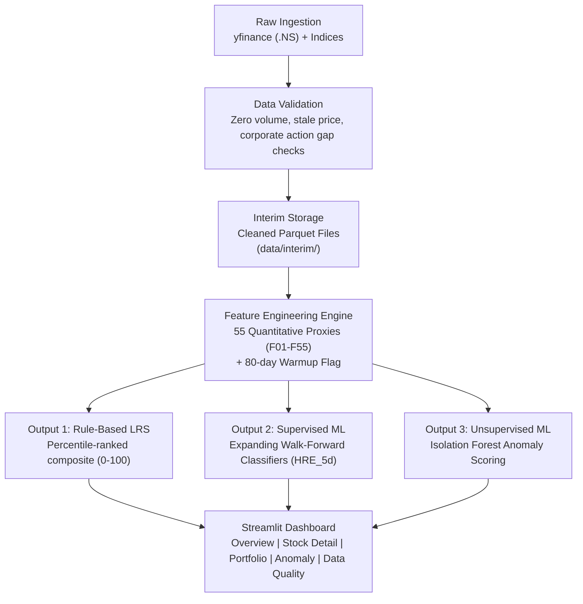

# ML-Based Liquidity and Trading-Risk Intelligence for Indian Equities

[](https://www.python.org/)
[](LICENSE)
[](https://parquet.apache.org/)
[](https://www.nseindia.com/)


## 1. Executive Summary

Liquidity fragmentation across market-capitalization tiers on the National Stock Exchange of India (NSE) creates severe execution risks for retail investors and non-institutional asset managers. Without expensive real-time Level-2 order books, market participants are vulnerable to sudden liquidity droughts, bid-ask spread blowouts, and overnight price gaps.

This project delivers a **quantitative decision-support platform** that transforms freely available daily OHLCV bars into interpretable risk intelligence:
1. **Rule-Based Composite Liquidity-Risk Score (LRS, 0–100):** Real-time instantaneous liquidity risk rating.
2. **Supervised 5-Day Forward High-Risk Event Forecasting ($HRE\_5d$):** Machine learning classifiers estimating the likelihood of a liquidity blowout over the next 5 trading days.
3. **Unsupervised Anomaly Detection (Isolation Forest):** Outlier scoring flagging unprecedented historical stock-day behaviors.

> **Crucial Disclaimer:** This system is an institutional-grade **risk intelligence and decision-support engine**. It is strictly **NOT** a stock price predictor, does not generate buy/sell alpha signals, and does not execute automated trades.

---

## 2. Research Questions & Hypotheses

* **Core Research Question:** *Can daily OHLCV bars and academic proxy estimators reliably forecast high-risk liquidity regimes without intraday order books? How does liquidity risk vary across market caps, and does macro volatility (India VIX) amplify it?*

| ID | Testable Hypothesis |
| :--- | :--- |
| **H1** | Amihud illiquidity is positively correlated with future high-risk liquidity events. |
| **H2** | Volume droughts ($<20\%$ of 20-day MA) precede increased overnight price gaps. |
| **H3** | Small-cap stocks exhibit systematically higher Amihud ratios than large-caps (verified via Mann-Whitney U test). |
| **H4** | Macro-volatility shocks (India VIX spikes) amplify single-stock illiquidity. |
| **H5** | Rolling return z-scores differentiate high-risk regimes from normal stock-day behavior. |
| **H6** | Isolation Forest anomaly scores correlate with periods later labeled as High-Risk Events. |
| **H7** | Tree ensembles (Random Forest / HistGradientBoosting) outperform Logistic Regression on minority class PR-AUC. |

---

## 3. Curated Universe & Dataset Scale

The dataset covers **300 curated Indian equities** spanning **8.8 years** from **January 1, 2018 to October 23, 2026** (565,190 stock rows + 6,499 index rows = **571,689 total observations**; over **3.95M data cells audited**).

```
                      STRATIFIED UNIVERSE (300 STOCKS)
                                     │
         ┌───────────────────────────┼───────────────────────────┐
         ▼                           ▼                           ▼
  100 Large-Caps              150 Mid-Caps                50 Small-Caps
  (Nifty 100 Index)        (Nifty Midcap 150)         (Curated by 6-mo ADTV)
  Liquid Anchor Baseline     Core Risk Variation         Illiquidity Tail
```

### Benchmarks & Context Indices:
- **`^NSEI` (NIFTY 50):** Broad-market benchmark for excess returns, rolling beta, and correlation.
- **`^NSEBANK` (NIFTY Bank):** High-beta financial sector index.
- **`^INDIAVIX`:** NSE market volatility index (implied fear gauge).
- **`market_events.csv`:** 87 manually curated systemic, macroeconomic, geopolitical, and corporate action events (e.g., COVID halts, Budget presentations, IL&FS default, stock splits).

---

## 4. System Architecture & BADIR Workflow

```
[B] Business Understanding  --> Framing liquidity risk for retail & portfolio managers
[A] Data Acquisition        --> Ingestion via yfinance (.NS tickers) with backoff & retry
[D] Data Integration        --> Tabular SSOT on composite key (ticker, date), calendar alignment
[I] Insights & Modeling     --> 55 features, LRS calibration, walk-forward ML, Isolation Forest
[R] Reporting & Delivery    --> Interactive 5-page Streamlit dashboard, audit manifests
```

### End-to-End Pipeline Dataflow:


---

## 5. The 55-Feature Engine (F01–F55)

The engine extracts 55 quantitative features across 6 distinct categories:

1. **Returns & Price Behaviour (10 features):** Simple/log returns, 5/20/60-day momentum, return z-scores, absolute returns, MA deviations.
2. **Volatility & Downside Risk (12 features):** Realized volatility, Parkinson high-low volatility, Average True Range (ATR), downside semi-deviation, max drawdown, RSI-14, volatility-of-volatility.
3. **Liquidity & Trading Activity (14 features):** Amihud illiquidity ratio, volume z-scores, turnover, zero-volume/stale-price flags, low-volume streaks.
4. **Price-Gap & Price-Impact Proxies (9 features):** Corwin-Schultz bid-ask spread estimate (floored at 0), normalized range, overnight price gaps, intraday returns.
5. **Market-Relative Behaviour (6 features):** Excess return vs NIFTY 50, 60-day rolling beta, rolling correlation, idiosyncratic volatility, relative volume.
6. **Market-Stress Features (5 features):** Benchmark volatility, volatility acceleration, market regime ratios, India VIX integration.

---

## 6. Why Apache Parquet?

All cleaned interim datasets and processed feature matrices are stored in **Apache Parquet (`.parquet`)**:
- **Columnar Storage:** Only loads required feature columns into memory rather than full rows, reducing disk I/O by 80–95%.
- **Snappy Compression:** Compresses 565,190 rows across 300 stocks into just **46.3 MB** (~85% smaller than CSV).
- **Strict Binary Typing:** Preserves `float32`, `datetime64[ns]`, `int64`, and `bool` datatypes natively without CSV parsing ambiguity.
- **Memory Optimization:** Explicit `float32` numeric casting halves runtime RAM consumption from ~248 MB to ~124 MB.

---

## 7. Project Structure

```text
Indian_Equities_Liquidity_Risk_ML/
├── README.md                          <- Main project overview and documentation
├── requirements.txt                   <- Pinned Python dependencies
├── .gitignore                         <- Version control rules
│
├── docs/                              <- Comprehensive architectural & academic specs
│   ├── ARCHITECTURE.md                <- Detailed system architecture & data contracts
│   ├── PROJECT_BLUEPRINT.md           <- Scope, objectives, hypotheses & deliverables
│   ├── UNIVERSE_SELECTION.md          <- Stratified universe methodology & ADTV ranking
│   ├── ADS_Group_8_One_Page_Summary.md<- Viva summary document
│   └── project_overview_liquidity_trading_risk.md
│
├── data/
│   ├── events/
│   │   └── market_events.csv          <- 87 curated market events (2018-2026)
│   ├── interim/                       <- Cleaned, validated, deduplicated datasets
│   │   ├── market/                    <- nifty50, banknifty, india_vix parquets
│   │   └── stocks/                    <- ohlcv_clean.parquet (565,190 rows)
│   ├── raw/                           <- Raw downloaded parquet files (git-ignored)
│   ├── processed/                     <- Feature-engineered matrices (git-ignored)
│   ├── predictions/                   <- Scored daily model predictions
│   └── manifests/                     <- Pipeline run audit logs and checksums
│
├── src/                               <- Production Python modules
│   ├── data/                          <- Fetcher, validator, and storage handlers
│   ├── features/                      <- Returns, volatility, liquidity, gaps, stress
│   ├── labels/                        <- LRS calculator and HRE_5d target builder
│   ├── modeling/                      <- Walk-forward trainer, scorer, anomaly model
│   ├── pipeline/                      <- Daily refresh orchestrator
│   └── utils/                         <- Structured logger, calendar helpers, configs
│
├── notebooks/                         <- Chronological Jupyter research notebooks
├── app/                               <- Multi-page Streamlit dashboard
├── models/                            <- Serialized model artifacts (.joblib)
├── logs/                              <- Runtime execution logs
└── tests/                             <- Unit test suite (pytest)
```

---

## 8. Installation & Setup

### 1. Clone the Repository
```bash
git clone https://github.com/BOSONBOSS/Indian_Equities_Liquidity_Risk_ML.git
cd Indian_Equities_Liquidity_Risk_ML
```

### 2. Create and Activate Virtual Environment
```bash
# macOS / Linux
python3 -m venv venv
source venv/bin/activate

# Windows
python -m venv venv
.\venv\Scripts\activate
```

### 3. Install Dependencies
```bash
pip install -r requirements.txt
```

---

## 9. Academic & Methodological Rigor

- **Leakage Prevention:** Expanding-window walk-forward validation (10 rolling folds); `StandardScaler` fitted strictly on training slices; 80-day warmup exclusion (`is_warmup=True`).
- **Class Imbalance Handling:** Prioritizes **PR-AUC (Precision-Recall AUC)** and **Brier Score** over traditional ROC-AUC due to 10–20% rare-event positive class representation.
- **Microstructure Safeguards:** Floored Corwin-Schultz spreads ($\ge 0$); corporate action gap reconciliations via event calendar.
- **Survivorship Bias Transparency:** Documented limitation arising from current constituent lists, mitigated by continuous listing-date tracking.
